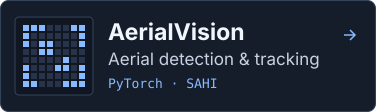
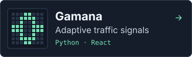
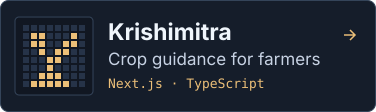
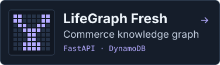

# Chethireddy Srikaran Reddy

**Full-stack development · Applied computer vision** · Hyderabad, India

I build web apps and turn computer vision experiments into tools people can use.

[Work](#selected-work) · [Toolkit](#toolkit) · [Activity](#contribution-activity) · [Contact](#contact)

[![GitHub stats for Sriikaran][stats-card]][repositories]

## Selected work

  
  

  
  

<strong>How they work · start with the code</strong>

- **AerialVision** uses tiled inference to detect small objects in aerial footage. [Detector configuration][detector] · [Benchmark results][benchmarks]
- **Gamana** turns tracked vehicles and lane pressure into signal timings and displays the decisions in a dashboard. [Signal controller][signal-controller] · [React dashboard][traffic-dashboard]
- **Krishimitra** connects a farmer-facing crop form to a recommendation API. [Crop guidance UI][crop-ui] · [Recommendation route][crop-api]
- **LifeGraph Fresh** connects shopping tasks and products in a commerce knowledge graph and evaluates purchase risks. [Graph service][lifegraph-graph] · [Risk controller][lifegraph-risk]

## Toolkit

**Computer vision** · Python, PyTorch, OpenCV, MMDetection, SAHI  
**Web** · TypeScript, React, Next.js, Tailwind CSS

<strong>See repository languages</strong>

[![Primary languages across original public repositories][languages-card]][repositories]

## Contribution activity

[![GitHub activity over the past year with active weeks and longest streak][activity-card]][contributions]

## Contact

[LinkedIn](https://linkedin.com/in/srikaranreddy) · [Email](mailto:mail2srikaran@gmail.com) · [All repositories][repositories]

[stats-card]: assets/profile-stats.svg
[languages-card]: assets/profile-languages.svg
[activity-card]: assets/profile-activity.svg
[repositories]: https://github.com/Sriikaran?tab=repositories
[contributions]: https://github.com/Sriikaran?tab=overview
[detector]: https://github.com/Sriikaran/AerialVision/blob/main/configs/custom_faster_rcnn_swin.py
[benchmarks]: https://github.com/Sriikaran/AerialVision/blob/main/BENCHMARK_RESULTS.md
[signal-controller]: https://github.com/Sriikaran/Gamana/blob/main/backend/modules/signal_controller.py
[traffic-dashboard]: https://github.com/Sriikaran/Gamana/blob/main/frontend/src/App.jsx
[crop-ui]: https://github.com/Sriikaran/Krishimitra/blob/main/app/crop-recommendation/page.tsx
[crop-api]: https://github.com/Sriikaran/Krishimitra/blob/main/app/api/crop-recommendation/route.ts
[lifegraph-graph]: https://github.com/Sriikaran/LifeGraph-Fresh/blob/main/src/domains/graph/service.py
[lifegraph-risk]: https://github.com/Sriikaran/LifeGraph-Fresh/blob/main/src/api/controllers/risk_controller.py
